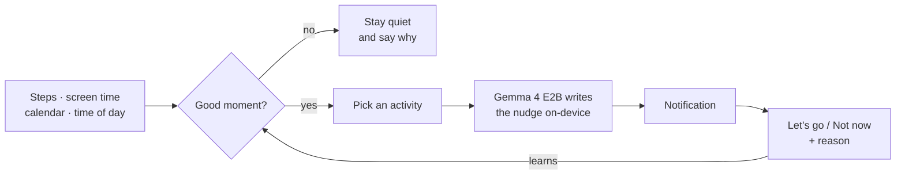

# Creative Detour 🌿

**Less screen, more world.** Creative Detour notices good moments in your day to move a little, and nudges you off your phone. The nudges are written by **Gemma 4 running entirely on your phone**.

Built for the [DEV Hacktoberfest Open-Source AI Challenge: Touch Grass](https://dev.to/challenges/hacktoberfest-week1-2026-10-05).

## What it does

- **Finds the right moment.** It watches your steps, screen time and calendar, and nudges you in the free gaps between events, never right before a meeting.
- **Suggests something doable.** A walk outside, a stretch, a mini workout, one song of dancing, a mindful minute outdoors…
- **Learns from you.** Tap *Let's go* or *Not now* plus a one-tap reason (Busy, Tired, Bad weather…). Detour backs off, adapts, and suggests more of what you actually do.
- **Explains itself.** Detour always tells you why it's staying quiet and when it will check again.

## How it works



## Install

1. Download the APK from [Releases](https://github.com/KrAG2000/creative-detour/releases/latest) and open it on your phone.
2. Follow the setup. Every permission is explained before Android asks for it.
3. *Optional:* download the AI model in the app (2.6 GB, Wi-Fi only). Without it, Detour uses hand-written nudges.

| | Requirement |
|---|---|
| Android | 8.0 or newer |
| AI nudges | 64-bit phone, ~4 GB RAM, 2.6 GB free space |

On first use, Detour tests your phone once and picks GPU or CPU, whichever works and is faster.

## Privacy

Everything stays on your phone. No account, no analytics, no server. The only network request is the one-time model download from Hugging Face.

## Build from source

```bash
git clone https://github.com/KrAG2000/creative-detour.git
cd creative-detour
./gradlew assembleDebug
```

Open it in Android Studio and press Run. More details in [CONTRIBUTING.md](CONTRIBUTING.md).

## Built with

Kotlin · Jetpack Compose · Room · [LiteRT-LM](https://github.com/google-ai-edge/LiteRT-LM) · [Gemma 4 E2B](https://huggingface.co/litert-community/gemma-4-E2B-it-litert-lm)

## License

[MIT](LICENSE.md). The Gemma 4 model is downloaded separately and is licensed under Apache 2.0.
